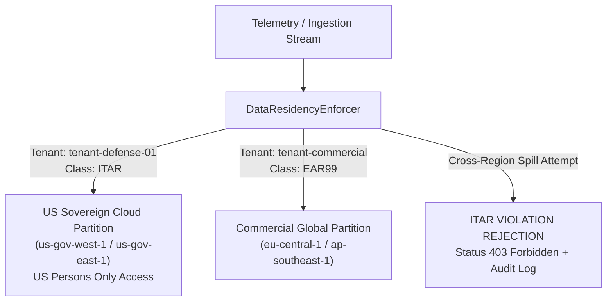

# Export Control Review (ITAR & EAR) & Data Residency

**System:** UAV Engine Digital Twin Platform  
**Document Ref:** EXP-CTRL-REV-2026-V1  
**Target Customer Base:** Defense Primes, Commercial MRO, NATO Operators  
**Applicable Regulations:** International Traffic in Arms Regulations (ITAR, 22 CFR 120-130), Export Administration Regulations (EAR, 15 CFR 730-774)  

---

## 1. Classification & Dual-Use Assessment

### 1.1 Commercial Engine Telemetry & Base Platform
- **Classification:** **EAR99** / **ECCN 9E003** (Technology for the development/production of propulsion systems).
- **Scope:** The standard Digital Twin algorithms, thermodynamics models (Rotax 914 4-stroke Otto cycle), physics residuals, and generic diagnostic architectures are dual-use commercial technologies developed from unclassified aerospace engineering principles.

### 1.2 Defense Customer Integration & Munitions List Review
- **USML Category VIII (Aircraft and Related Articles):**
  - Category VIII(h)(1): Parts, components, accessories, attachments, and associated equipment specially designed for defense aircraft.
- **Determination:**
  - When the Digital Twin is deployed to process telemetry from ITAR-controlled defense military UAV airframes (e.g. Predator/Reaper class, loitering munitions), the ingested telemetry, flight logs, and airframe-specific damage matrices become **ITAR-Controlled Technical Data**.
  - **Ground-Side Exemption:** The platform is ground-side decision support and does not include autonomous weapon delivery or airborne flight control software. However, the data stored and models tuned on defense flights must remain strictly within sovereign boundaries.

---

## 2. Technical Safeguards & Data Residency Pinning

To guarantee compliance without impeding commercial sales:

1. **Sovereign Region Pinning:**
   - Defense tenants (`tenant-defense-01`, `tenant-dod-af`, etc.) are hard-pinned to AWS GovCloud / Azure Government partitions (`us-gov-west-1`, `us-gov-east-1`).
   - [`DataResidencyEnforcer.validate_tenant_dispatch`](file:///home/rishi/UAV_Digital_Twin/packages/twin-core/twin_core/security_compliance.py) intercepts every storage or federated learning request. Any attempt to route ITAR-classified data to a commercial foreign region (e.g. `eu-central-1`) is immediately blocked and logged as an export violation attempt.
2. **Strict Personnel Controls (US Persons Only):**
   - Maintenance of US GovCloud partitions is restricted to vetted US Citizens / Permanent Residents.
3. **No Cross-Border Federated Learning for ITAR Tenants:**
   - ITAR tenant federated learning rounds operate exclusively in isolated GovCloud aggregation enclaves; ITAR weight deltas never mix with commercial European or Asian fleet rounds.
