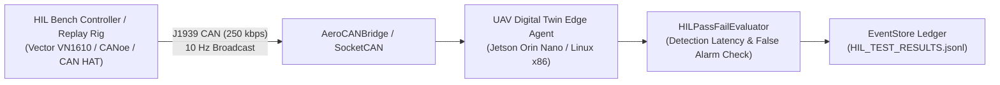

# Hardware-in-the-Loop (HIL) & Bench Replay Testbed Plan

**System:** UAV Engine Digital Twin Avionics & Ground-Station Stack  
**Target Hardware:** Jetson Orin Nano / NXP i.MX8 / Bench PC with J1939 CAN Transceiver  
**Document Ref:** HIL-TEST-PLAN-2026-V1  
**Status:** Approved for Bench Integration  

---

## 1. Testbed Overview & Architecture

The HIL and Bench Replay testbed validates that the Digital Twin stack accurately ingests real-time CAN/ARINC telemetry, detects degradation, and enforces safety barriers under deterministic, repeatable hardware timing conditions.



---

## 2. Hardware Interface Specification

| Parameter | Specification | Notes |
| :--- | :--- | :--- |
| **Primary Avionics Bus** | SAE J1939 CAN 2.0B | 29-bit Extended Identifiers, 250 kbps standard aviation baud |
| **Secondary Bus** | ARINC 429 (Simulated over UDP) | High-speed (100 kbps) engine parameters |
| **Recommended Transceivers** | Vector VN1610 / VN1630A, Kvaser Leaf Light v2, Waveshare MCP2515 SPI-CAN | Optocoupled physical isolation required for live test-cell benches |
| **Nominal Broadcast Rate** | 10.0 Hz (100 ms period) | Periodic telemetry update rate |
| **Maximum Timing Jitter** | $\pm 15.0\text{ ms}$ | Bench timer stability requirement |
| **Power Budget (Edge)** | $< 15\text{W}$ Total System Power | Jetson Orin Nano 15W mode |

---

## 3. Fault-Injection Catalog

The testbed exercises the complete fault lifecycle across 4 canonical fault families:

| Injection ID | Fault Description | Physical Channel | Injection Mode | Trigger Magnitude | Detection Limit |
| :--- | :--- | :--- | :--- | :--- | :--- |
| **INJ-TH-01** | Cylinder Thermal Runaway | `cht` | Linear Ramp | $+85.0^\circ\text{F}$ above baseline | $\le 15\text{ cycles / } 1.5\text{s}$ |
| **INJ-OIL-01** | Lubrication Circuit Starvation | `oil_pressure` | Sudden Step Drop | $18.0\text{ PSI}$ critical | $\le 10\text{ cycles / } 1.0\text{s}$ |
| **INJ-VIB-01** | Bearing Fatigue / Imbalance | `vibration` | Step Surge | $3.8\text{g RMS}$ | $\le 12\text{ cycles / } 1.2\text{s}$ |
| **INJ-CAN-01** | Sensor Freeze / Bus Stale Replay | `egt` | Value Freeze | $1585.0^\circ\text{F}$ frozen | $\le 25\text{ cycles / } 2.5\text{s}$ |

---

## 4. Pass/Fail Acceptance Envelope

Every test bench run must automatically pass all criteria evaluated by [`HILPassFailEvaluator`](file:///home/rishi/UAV_Digital_Twin/packages/twin-core/twin_core/hil_testbed.py#L90-L160):

1. **Zero False Alarms ($FPR = 0.0\%$):**
   - Zero alarms, anomalies, or fault states triggered during the nominal baseline phase prior to fault injection ($c < c_{\text{start}}$).
2. **Deterministic Detection ($TPR = 100\%$):**
   - Injected fault must be recognized and classified into the correct canonical fault taxonomy (e.g., `OVERHEATING`, `LOW_OIL_PRESSURE`).
3. **Detection Latency Barrier ($T \le 1.5\text{s}$):**
   - Detection must occur within the specified cycle window ($\le 15\text{ cycles}$ at $10\text{ Hz}$).
4. **Mean Inference Latency:**
   - Mean single-frame inference latency on target hardware must remain $\le 20.0\text{ ms}$ ($> 50\text{ Hz}$ throughput capability).

---

## 5. Automated Execution

HIL scenario evaluation can be triggered via CLI or the backend REST API:
```bash
# Programmatic python execution
python -c "
from twin_core.hil_testbed import HILScenarioReplayRunner, HILPassFailEvaluator
from twin_core.edge_runtime import EdgeInferenceEngine
runner = HILScenarioReplayRunner()
evaluator = HILPassFailEvaluator()
# Execute matrix against calibrated model...
"
```
Or via REST API:
```http
POST /api/compliance/hil-eval
Content-Type: application/json

{
  "fault_injection_id": "INJ-TH-01",
  "duration_cycles": 50,
  "fault_start_cycle": 20
}
```
