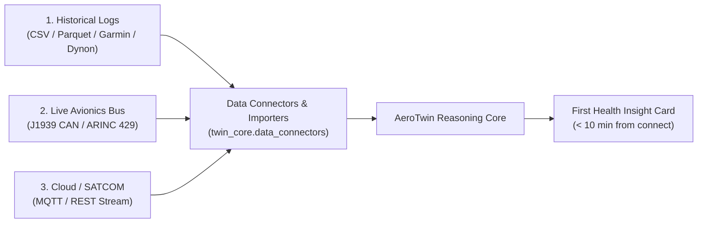

# Customer Telemetry Onboarding Guide (Time-to-First-Insight < 10 Minutes)

**Product:** AeroTwin Propulsion Digital Twin  
**Audience:** Customer Flight Operations Engineers, Avionics Technicians, MRO Planners  
**Objective:** Connect live or recorded engine telemetry to the Digital Twin and generate your first health insight card in under 10 minutes.

---

## 1. Quick Ingestion Options

Choose the connect method that matches your existing aircraft or test bench setup:



---

## Option A: Historical Flight CSV / Parquet Backfill (Fastest — 3 Minutes)

If you have flight data recordings from avionics (Garmin G3X, Dynon SkyView, Grand Rapids Technologies, or test-cell CSVs):

1. **Format Check:** Ensure your CSV contains at least 3 of the following basic channels (column names are auto-detected):
   - Engine Speed: `RPM`, `Eng_RPM`, `Tach`
   - Cylinder Head Temperature: `CHT`, `CHT1`, `Cyl_Head_Temp`
   - Exhaust Gas Temperature: `EGT`, `EGT1`, `Exhaust_Gas_Temp`
   - Lubrication: `Oil_Pressure`, `OilP`, `Oil_Temp`
2. **Ingest via CLI or REST:**
   ```bash
   # Upload customer CSV directly to the local backfill endpoint
   curl -X POST http://localhost:8766/api/ingest/backfill \
     -H "Content-Type: text/csv" \
     --data-binary @flight_recording_2026_10_08.csv
   ```
3. **Inspect First Insight Card:**
   Within $< 1.0\text{ second}$, the system outputs:
   - Overall Engine Health Index ($0\text{–}100\%$)
   - Detected thermal or pressure anomalies
   - Prescriptive ATA chapter recommendations

---

## Option B: Live Avionics CAN Bus (SAE J1939)

1. **Hardware Transceiver:** Connect your bench transceiver (Vector VN1610, Kvaser Leaf Light v2, or Raspberry Pi CAN HAT) to the aircraft engine J1939 port.
2. **Standard PGN Mapping:**
   - **PGN 61444 (EEC1):** Bytes 4–5 $\rightarrow$ Engine RPM ($0.125\text{ RPM/bit}$).
   - **PGN 65262 (ET1):** Byte 1 $\rightarrow$ Coolant/CHT; Bytes 3–4 $\rightarrow$ Oil Temperature.
   - **PGN 65263 (EFL/P1):** Byte 4 $\rightarrow$ Oil Pressure ($4\text{ kPa/bit}$).
3. **Bridge Launch:**
   ```bash
   # Bind SocketCAN interface at 250 kbps
   python simulator/can_bridge.py --interface can0 --bitrate 250000
   ```

---

## Option C: Cloud & SATCOM MQTT Stream

1. **Broker Endpoint:** `mqtts://telemetry.aerotwin.io:8883`
2. **Topic Hierarchy:**
   `uav/engine/{tenant_id}/{aircraft_id}/telemetry`
3. **Payload Structure:**
   ```json
   {
     "aircraft_id": "UAV-104",
     "tenant_id": "tenant-commercial-01",
     "timestamp": 1760001000.5,
     "channels": {
       "rpm": 2420.0,
       "cht": 382.4,
       "egt": 1582.0,
       "oil_pressure": 57.8,
       "vibration": 0.64
     }
   }
   ```

---

## 2. Onboarding Verification Checklist

- [ ] Telemetry stream connected and validated.
- [ ] Auto-mapped channel count $\ge 4$ canonical features.
- [ ] First insight card generated without errors.
- [ ] Baseline nominal distributions confirmed with flight engineer.
