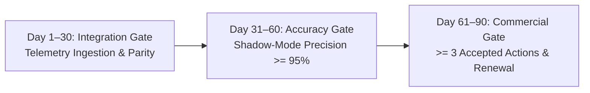

# Pilot-to-Production Playbook & Design Partner Framework

**Document Ref:** GTM-PILOT-2026-V1  
**Target Program:** 90-Day Paid Customer Pilot Program  
**Objective:** Transition prospective operators from initial trial to annual production contract with measurable operational proof.

---

## 1. 30 / 60 / 90-Day Milestone Gates

### Day 1–30: Integration & Baseline Convergence
- **Milestone Criteria:**
  1. Live telemetry streaming or daily batch backfills established for $\ge 3$ aircraft.
  2. Zero data loss during standard flight operations ($> 99.5\%$ packet ingestion).
  3. Per-tail nominal baseline distributions converged in [`TelemetryDriftDetector`](file:///home/rishi/UAV_Digital_Twin/packages/twin-core/twin_core/drift_detector.py).
- **Deliverable:** Signed Day-30 Integration Acceptance Memorandum.

### Day 31–60: Diagnostic Accuracy & Shadow-Mode Validation
- **Milestone Criteria:**
  1. Diagnostic Precision: True fault detection rate $\ge 95\%$ on confirmed engine events.
  2. False Alarm Rejection: Zero false engine pull recommendations caused by sensor drift.
  3. Shadow-mode candidate model parity verified via [`ShadowModeRunner`](file:///home/rishi/UAV_Digital_Twin/packages/twin-core/twin_core/model_governance.py).
- **Deliverable:** 60-Day Mid-Pilot Performance Review & ROI Analysis.

### Day 61–90: Value Realization & Production Conversion
- **Milestone Criteria:**
  1. Maintenance Acceptance: $\ge 3$ prescriptive maintenance recommendations adopted by customer maintenance team.
  2. Measured Downtime Saved: Documented avoidance of unscheduled AOG downtime ($\ge 12\text{ hours}$ confirmed saved).
  3. Executive Sign-Off: Transition to multi-year Enterprise Fleet Cloud contract.

---

## 2. Discovery Call Interview Script

For sales engineers and founders conducting initial operator calls:

1. **Fleet & Powertrain:**
   - *"What engine models power your UAV fleet (Rotax 912/914, Continental, heavy fuel)?"*
   - *"How many flight hours do you average per tail per month?"*
2. **Current Pain Points:**
   - *"How often does a thermocouple or sensor failure force you into an unscheduled engine swap?"*
   - *"What is your estimated hourly cost when an aircraft is grounded awaiting inspection?"*
3. **Data Availability:**
   - *"Do your avionics log to SD card (Garmin/Dynon CSV), or do you broadcast CAN/J1939 over telemetry downlinks?"*
4. **Closing to Pilot:**
   - *"If we can ingest a sample log today and prove zero false alarms on your historical flights in under 10 minutes, would you be open to a 90-day shadow-mode trial?"*
