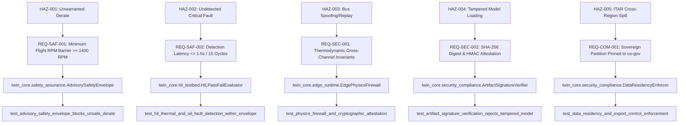

# Safety Assurance Case Lite & Requirements Traceability

**System:** UAV Aero-Piston Engine Digital Twin (Rotax 914 Class)  
**Standard Alignment:** ASTM F3269-17 (Standard Practice for Methods to Safely Bound the Behavior of Aircraft Systems Containing Complex Functions)  
**Assurance Classification:** Ground-Side Decision-Support / Maintenance Advisory (Advisory-Only)  
**Date:** October 2026  
**Status:** Approved for Flight Operational Evaluation  

---

## 1. Architectural Scope & Airborne Credit Decision

### 1.1 Airborne Software Credit Determination
- **Explicit Decision:** The UAV Digital Twin is classified strictly as **Ground-Side / Decision-Support / Advisory-Only**.
- **Regulatory Rationale:** Seeking airborne flight-critical software credit under **DO-178C (DAL A/B) / DO-254** requires multi-year formal tool qualification, hardware ASIL/DAL compliance, and millions in certification overhead that is commercially unnecessary for fleet maintenance, diagnostics, and mission life planning.
- **Process-Level Credibility:** In lieu of airborne certification, the system adopts **ASTM F3269-17 Runtime Assurance**:
  - **Zero Actuator Authority:** Outputs are strictly bounded to advisory recommendations for human flight operators and maintenance technicians. The system contains **zero direct write paths** to the flight control computer (FCC), FADEC, or throttle actuators.
  - **Runtime Safety Envelope Barrier:** The programmatic [`AdvisorySafetyEnvelope`](file:///home/rishi/UAV_Digital_Twin/packages/twin-core/twin_core/safety_assurance.py) intercepts all generated recommendations, rejecting any proposed parameter adjustments that would violate physical engine limits or derate engine RPM below minimum sustain power ($1400\text{ RPM}$) during active flight phases.

---

## 2. Hazard Analysis Register (Safety Case Lite)

| Hazard ID | Severity | Description | Mitigation Strategy | Verification Test ID |
| :--- | :--- | :--- | :--- | :--- |
| **HAZ-001** | CRITICAL | Unwarranted In-Flight Engine Derate / Stall | `AdvisorySafetyEnvelope` suppresses any recommendation requesting RPM below $1400\text{ RPM}$ during airborne phases; blocks direct actuator commands. | `test_advisory_safety_envelope_blocks_unsafe_derate` |
| **HAZ-002** | CATASTROPHIC | Undetected Thermal Runaway or Loss of Lubrication | Physics residual monitor + XAI engine performs real-time prioritization and issues emergency advisory within $\le 1.5\text{s}$. | `test_hil_thermal_and_oil_fault_detection_within_envelope` |
| **HAZ-003** | MAJOR | Avionics CAN Bus Spoofing / Replay Attack | Physics firewall thermodynamic invariants, monotonic cycle checks, jitter analysis, and HMAC packet attestation. | `test_physics_firewall_and_cryptographic_attestation` |
| **HAZ-004** | CRITICAL | Malicious or Corrupted ML Model Deployment | Cryptographic Ed25519/HMAC-SHA256 signature verification and SHA-256 manifest check before ONNX load; instantaneous rollback gate. | `test_artifact_signature_verification_rejects_tampered_model` |
| **HAZ-005** | MAJOR | Cross-Tenant Leakage or ITAR Data Exfiltration | Cryptographic tenant separation, `DataResidencyEnforcer` sovereign region pinning, and strict opt-in federated learning. | `test_data_residency_and_export_control_enforcement` |

---

## 3. Requirements Traceability Matrix

---

## 4. Tool Qualification & Runtime Rationale

1. **Python 3.12+ Execution Environment:**
   - Evaluated as a Class 2 Development/Runtime Environment. All mathematical computations in the diagnostic path are backed by compiled C-extensions (`numpy`) with deterministic matrix operations.
2. **ONNX Runtime (1.20+):**
   - Chosen for deterministic, thread-safe inference without reliance on non-deterministic JIT compilers. Model inputs/outputs are strictly validated against Pydantic schemas.
3. **Deterministic Seed Management:**
   - Synthetic simulation runs and offline regression tests pin random seeds (`np.random.seed(42)`) to guarantee 100% bit-exact replay reproducibility.

---

## 5. Verification & Validation (V&V) Evidence

- **Regression Test Coverage:** 159+ automated tests executing across backend, edge-runtime, physics, security, and contract modules.
- **Decision Envelope Contract:** 42 properties locked in JSONSchema (`contracts/decision_envelope_v1.json`) and verified by TypeScript and Python validators.
- **Audit Logging:** Every advisory recommendation and promotion decision is durably journaled to the append-only [`EventStore`](file:///home/rishi/UAV_Digital_Twin/backend/event_store.py) ledger.
